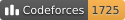
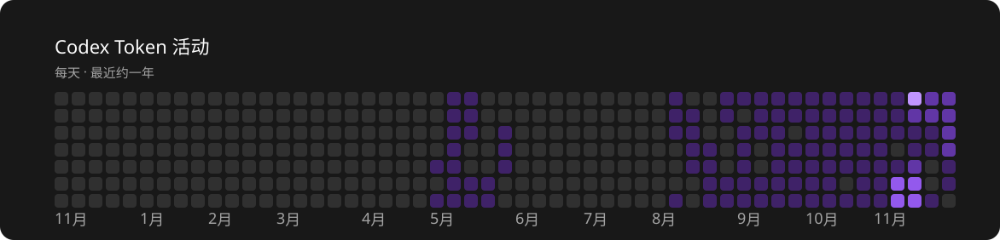
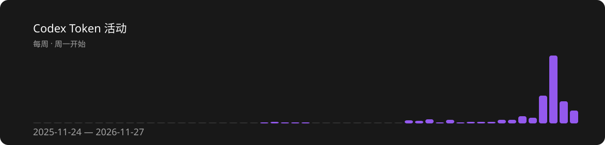
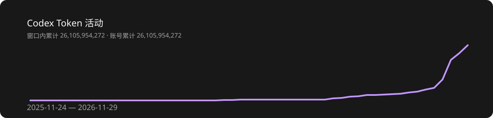
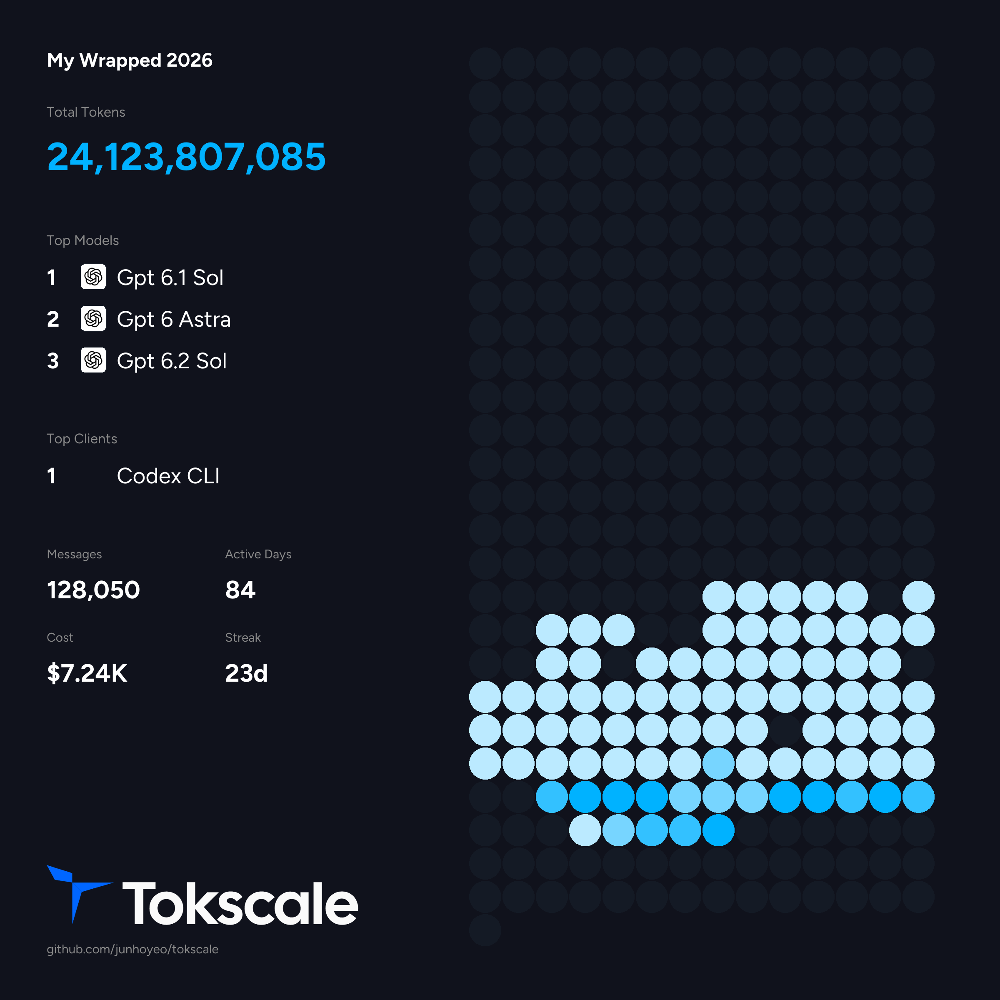
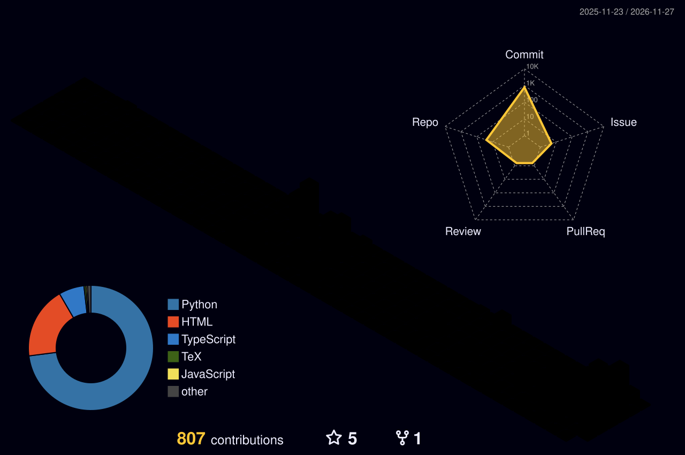

<!-- 顶部打字动画 - 全宽居中 -->
<div align="center">
  <a href="https://git.io/typing-svg">
    
  </a>
</div>

<p align="center">
  <a href="https://space.bilibili.com/481036572"></a>&nbsp;&nbsp;
  <a href="https://www.xiaohongshu.com/user/profile/5e72db210000000001000d66"></a>&nbsp;&nbsp;
  &nbsp;&nbsp;
  <a href="https://wakatime.com/@SakuraLoveForever"></a>&nbsp;&nbsp;
  <a href="https://codeforces.com/profile/Sakura_Love">
    
  </a>&nbsp;&nbsp;
  <a href="https://www.luogu.com.cn/user/233253">
    
  </a>
</p>

<div align="center">
  <picture>
    <source media="(prefers-color-scheme: dark)" srcset="https://raw.githubusercontent.com/SakuraLoveForever/SakuraLoveForever/refs/heads/output/github-contribution-grid-snake-dark.svg">
    <source media="(prefers-color-scheme: light)" srcset="https://raw.githubusercontent.com/SakuraLoveForever/SakuraLoveForever/refs/heads/output/github-contribution-grid-snake.svg">
    
  </picture>
</div>

<p align="center">
  &nbsp;
  &nbsp;
  <br>
  &nbsp;
  &nbsp;
  <br>
  &nbsp;
</p>

<p align="center">
  <a href="https://raw.githubusercontent.com/SakuraLoveForever/SakuraLoveForever/main/assets/codex-activity-daily.svg">
    
  </a>
  <br>
  <sub>点击图表打开原图，悬停方格查看当天的 Token 用量。</sub>
</p>

<details>
<summary>Codex Token 活动 · 每周</summary>



</details>

<details>
<summary>Codex Token 活动 · 累计总量</summary>



</details>

<details>
<summary>Tokscale 原生 token 可视化</summary>

<div align="center">
  
</div>

</details>

<!--START_SECTION:waka-->
**🐱 My GitHub Data** 

> 📦 993.8 kB Used in GitHub's Storage 
 > 
> 🏆 712 Contributions in the Year 2026
 > 
> 🚫 Not Opted to Hire
 > 
> 📜 22 Public Repositories 
 > 
> 🔑 2 Private Repositories 
 > 
**I'm a Night 🦉** 

```text
🌞 Morning                258 commits         ⬛⬛⬛⬛⬜⬜⬜⬜⬜⬜⬜⬜⬜⬜⬜⬜⬜⬜⬜⬜⬜⬜⬜⬜⬜   16.61 % 
🌆 Daytime                440 commits         ⬛⬛⬛⬛⬛⬛⬛⬜⬜⬜⬜⬜⬜⬜⬜⬜⬜⬜⬜⬜⬜⬜⬜⬜⬜   28.33 % 
🌃 Evening                378 commits         ⬛⬛⬛⬛⬛⬛⬜⬜⬜⬜⬜⬜⬜⬜⬜⬜⬜⬜⬜⬜⬜⬜⬜⬜⬜   24.34 % 
🌙 Night                  477 commits         ⬛⬛⬛⬛⬛⬛⬛⬛⬜⬜⬜⬜⬜⬜⬜⬜⬜⬜⬜⬜⬜⬜⬜⬜⬜   30.71 % 
```
📅 **I'm Most Productive on Tuesday** 

```text
Monday                   270 commits         ⬛⬛⬛⬛⬜⬜⬜⬜⬜⬜⬜⬜⬜⬜⬜⬜⬜⬜⬜⬜⬜⬜⬜⬜⬜   17.39 % 
Tuesday                  421 commits         ⬛⬛⬛⬛⬛⬛⬛⬜⬜⬜⬜⬜⬜⬜⬜⬜⬜⬜⬜⬜⬜⬜⬜⬜⬜   27.11 % 
Wednesday                173 commits         ⬛⬛⬛⬜⬜⬜⬜⬜⬜⬜⬜⬜⬜⬜⬜⬜⬜⬜⬜⬜⬜⬜⬜⬜⬜   11.14 % 
Thursday                 193 commits         ⬛⬛⬛⬜⬜⬜⬜⬜⬜⬜⬜⬜⬜⬜⬜⬜⬜⬜⬜⬜⬜⬜⬜⬜⬜   12.43 % 
Friday                   153 commits         ⬛⬛⬜⬜⬜⬜⬜⬜⬜⬜⬜⬜⬜⬜⬜⬜⬜⬜⬜⬜⬜⬜⬜⬜⬜   09.85 % 
Saturday                 187 commits         ⬛⬛⬛⬜⬜⬜⬜⬜⬜⬜⬜⬜⬜⬜⬜⬜⬜⬜⬜⬜⬜⬜⬜⬜⬜   12.04 % 
Sunday                   156 commits         ⬛⬛⬛⬜⬜⬜⬜⬜⬜⬜⬜⬜⬜⬜⬜⬜⬜⬜⬜⬜⬜⬜⬜⬜⬜   10.05 % 
```


📊 **This Week I Spent My Time On** 

```text
🕑︎ Time Zone: Asia/Shanghai

💬 Programming Languages: 
Python                   63 hrs 41 mins      ⬛⬛⬛⬛⬛⬛⬛⬛⬛⬛⬛⬛⬛⬛⬛⬛⬛⬛⬛⬛⬜⬜⬜⬜⬜   79.66 % 
Markdown                 7 hrs 5 mins        ⬛⬛⬜⬜⬜⬜⬜⬜⬜⬜⬜⬜⬜⬜⬜⬜⬜⬜⬜⬜⬜⬜⬜⬜⬜   08.86 % 
Other                    3 hrs 29 mins       ⬛⬜⬜⬜⬜⬜⬜⬜⬜⬜⬜⬜⬜⬜⬜⬜⬜⬜⬜⬜⬜⬜⬜⬜⬜   04.36 % 
JavaScript               2 hrs 47 mins       ⬛⬜⬜⬜⬜⬜⬜⬜⬜⬜⬜⬜⬜⬜⬜⬜⬜⬜⬜⬜⬜⬜⬜⬜⬜   03.49 % 
JSON                     51 mins             ⬜⬜⬜⬜⬜⬜⬜⬜⬜⬜⬜⬜⬜⬜⬜⬜⬜⬜⬜⬜⬜⬜⬜⬜⬜   01.08 % 

🔥 Editors: 
Codex Vscode             79 hrs 20 mins      ⬛⬛⬛⬛⬛⬛⬛⬛⬛⬛⬛⬛⬛⬛⬛⬛⬛⬛⬛⬛⬛⬛⬛⬛⬛   99.22 % 
Codex CLI                37 mins             ⬜⬜⬜⬜⬜⬜⬜⬜⬜⬜⬜⬜⬜⬜⬜⬜⬜⬜⬜⬜⬜⬜⬜⬜⬜   00.78 % 

🐱‍💻 Projects: 
Macro                    70 hrs 32 mins      ⬛⬛⬛⬛⬛⬛⬛⬛⬛⬛⬛⬛⬛⬛⬛⬛⬛⬛⬛⬛⬛⬛⬜⬜⬜   88.23 % 
None                     3 hrs 34 mins       ⬛⬜⬜⬜⬜⬜⬜⬜⬜⬜⬜⬜⬜⬜⬜⬜⬜⬜⬜⬜⬜⬜⬜⬜⬜   04.47 % 
website_Sakura_Love      2 hrs 32 mins       ⬛⬜⬜⬜⬜⬜⬜⬜⬜⬜⬜⬜⬜⬜⬜⬜⬜⬜⬜⬜⬜⬜⬜⬜⬜   03.17 % 
PC_System_Auto_Scripts   41 mins             ⬜⬜⬜⬜⬜⬜⬜⬜⬜⬜⬜⬜⬜⬜⬜⬜⬜⬜⬜⬜⬜⬜⬜⬜⬜   00.87 % 
auto_clean               40 mins             ⬜⬜⬜⬜⬜⬜⬜⬜⬜⬜⬜⬜⬜⬜⬜⬜⬜⬜⬜⬜⬜⬜⬜⬜⬜   00.85 % 

💻 Operating System: 
Windows                  79 hrs 57 mins      ⬛⬛⬛⬛⬛⬛⬛⬛⬛⬛⬛⬛⬛⬛⬛⬛⬛⬛⬛⬛⬛⬛⬛⬛⬛   100.00 % 
```

**I Mostly Code in Python** 

```text
Python                   9 repos             ⬛⬛⬛⬛⬛⬛⬛⬛⬛⬛⬜⬜⬜⬜⬜⬜⬜⬜⬜⬜⬜⬜⬜⬜⬜   40.91 % 
HTML                     6 repos             ⬛⬛⬛⬛⬛⬛⬛⬜⬜⬜⬜⬜⬜⬜⬜⬜⬜⬜⬜⬜⬜⬜⬜⬜⬜   27.27 % 
Kotlin                   1 repo              ⬛⬜⬜⬜⬜⬜⬜⬜⬜⬜⬜⬜⬜⬜⬜⬜⬜⬜⬜⬜⬜⬜⬜⬜⬜   04.55 % 
C                        1 repo              ⬛⬜⬜⬜⬜⬜⬜⬜⬜⬜⬜⬜⬜⬜⬜⬜⬜⬜⬜⬜⬜⬜⬜⬜⬜   04.55 % 
TeX                      1 repo              ⬛⬜⬜⬜⬜⬜⬜⬜⬜⬜⬜⬜⬜⬜⬜⬜⬜⬜⬜⬜⬜⬜⬜⬜⬜   04.55 % 
```


 Last Updated on 15/11/2026 23:01:41 UTC
<!--END_SECTION:waka-->

<!-- 空行分隔 -->
<div>&nbsp;</div>

<div align="center">
  
</div>

<div align="center">
  <table>
    <tr>
      <td align="center">
        <a href="https://github.com/stats-organization/github-stats-extended">
          
        </a>
      </a>
      <td align="center">
        <a href="https://git.io/streak-stats">
          
        </a>
      </a>
    </tr>
    <tr>
      <td align="center" width="50%">
        <a href="https://github.com/stats-organization/github-stats-extended">
          
        </a>
      </a>
      <td align="center" width="50%">
        
      </a>
    </tr>
  </table>
</div>

<div>&nbsp;</div>

<div align="center">
  <a href="https://github.com/lowlighter/metrics">
    
  </a>
</div>

<div>&nbsp;</div>

<div align="center">
  <table>
    <!-- 第 2 行：语言统计 和 Star 仓库 -->
    <tr>
      <td align="center">
        
      </td>
      <td align="center">
        
      </td>
    </tr>
    <!-- 第 3 行（原第 1 行）：日历类 -->
    <tr>
      <td align="center">
        
      </td>
      <td align="center">
        
      </td>
    </tr>
  </table>
</div>

<div align="center">
  
</div>
